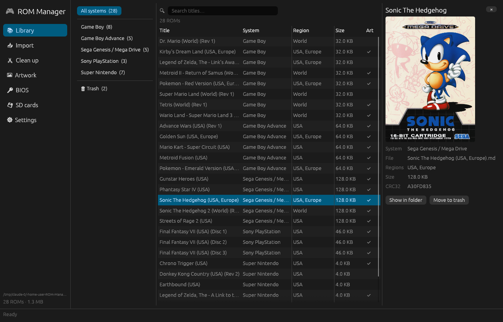
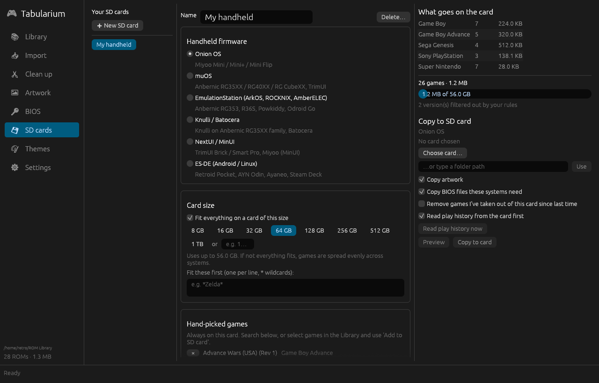

# ROM Manager

A desktop app for Windows, macOS and Linux that organises a retro game ROM
collection, weeds out duplicates and junk, downloads artwork, checks BIOS
files, and builds ready-to-use SD cards for handhelds (Onion OS, muOS,
ArkOS/ROCKNIX, Knulli/Batocera, NextUI/MinUI and ES-DE).



## Download

Builds for every platform are produced by GitHub Actions:

* **Releases page**: tagged versions (`v0.2.0`, …) attach installers to a GitHub release.
* **Actions tab**: every push has downloadable build artifacts.

| Platform | File | Notes |
|---|---|---|
| Windows 10/11 | `rom-manager-windows-x86_64.zip` | Unzip and run `ROM Manager.exe`. The app isn't code-signed, so SmartScreen may warn: choose *More info → Run anyway*. |
| macOS 11+ (Apple Silicon & Intel) | `rom-manager-macos-universal.dmg` | Drag *ROM Manager* to Applications. It isn't notarised: the first time, right-click the app → *Open* → *Open* (or allow it in System Settings → Privacy & Security). |
| Linux x86_64 | `ROM-Manager-x86_64.AppImage` | `chmod +x` it and run. Or use the `.tar.gz` and run `./install.sh` to add it to your applications menu. |

## How it works

```
your messy folders ──Import──▶ LIBRARY (sorted by system, indexed)
                                  │  Clean up  → duplicates / 1G1R / betas… → trash (restorable)
                                  │  Artwork   → box art downloaded once
                                  │  BIOS      → verified BIOS files
                                  ▼
                       SD cards (one per handheld) ──Copy to card──▶ microSD
```

1. **Create a library.** Pick a folder with plenty of space. ROMs get copied
   (or moved) into it, sorted by system.
2. **Import.** Add or drag in the folders where your ROMs live now. The
   system is worked out from the file extension, what's inside zips, folder
   names ("PS1", "megadrive", "Game Boy (GB)") or the file's header (Genesis,
   32X, PS1, PSP, Sega CD, Saturn). Byte-identical copies are skipped, even a
   zipped and an unzipped copy of the same game. Use *Preview* first to see
   what will happen.
3. **Clean up** (optional). Tick what you don't want (betas, prototypes,
   demos, hacks, bad dumps…) and turn on *one game, one ROM* to keep only
   the best region and latest revision of each game. Results go to the trash,
   and nothing is deleted until you empty it.
4. **Artwork.** Download box art, screenshots or title screens.
5. **BIOS.** See which systems need a BIOS, import the files (they're
   recognised by MD5, whatever they're named), and check an SD card.
6. **SD cards.** Make one entry per handheld:
   * the firmware it runs (sets the folder layout);
   * the systems to include;
   * which versions of each game (the same filters as Clean up, without
     changing your library);
   * the card size: games are spread fairly across systems if it won't all
     fit, with any you mark as priorities going first.

   A live preview shows what fits. *Copy to card* then writes the ROMs,
   resized artwork, `.m3u` playlists for multi-disc games, `gamelist.xml`
   where the firmware uses one, and the BIOS files those systems need.
   Copying again only transfers what changed. *Remove games I've taken out*
   deletes only files the app itself put on the card, never your saves.



## Supported handheld firmware

| Firmware | Devices | ROMs | Artwork | BIOS |
|---|---|---|---|---|
| Onion OS | Miyoo Mini / Mini+ / Flip | `Roms/GB/` | `Roms/GB/Imgs/` (250px) | `BIOS/` |
| muOS | Anbernic RG35XX/40XX/CubeXX, TrimUI | `ROMS/gb/` | `MUOS/info/catalogue/<System>/box/` | `MUOS/bios/` |
| EmulationStation | ArkOS, ROCKNIX, AmberELEC | `roms/gb/` | `roms/gb/images/` + `gamelist.xml` | `roms/bios/` |
| Knulli / Batocera | Anbernic RG35XX family, PCs | `roms/gb/` (`megadrive`, `lynx`…) | `roms/gb/images/` + `gamelist.xml` | `bios/` |
| NextUI / MinUI | TrimUI Brick / Smart Pro, Miyoo | `Roms/Game Boy (GB)/` | `Roms/…/.media/` (300px) | `Bios/GB/` |
| ES-DE | Retroid Pocket, AYN Odin, Ayaneo, Steam Deck | `ROMs/gb/` | `ES-DE/downloaded_media/gb/covers/` | `RetroArch/system/` |

PS2, GameCube, 3DS and Xbox need powerful hardware (Retroid / Odin-class
Android devices, or a PC running Batocera or ES-DE). Low-power handhelds
like the Miyoo Mini can't run them, but their folder names are still defined.

BIOS checks include every PS2 BIOS dump known to libretro (by hash), the
Xbox files xemu needs (`mcpx_1.0.bin`, `Complex_4627.bin`,
`xbox_hdd.qcow2`, by name), and the optional GameCube IPL and DOS MT-32 ROMs.

Firmware updates sometimes rename folders. Every system's folder name can be
overridden per SD card under *Artwork and extras → Folder names on the card*.

44 systems are supported: NES, Famicom Disk System, SNES, Game Boy / Color /
Advance, N64, DS, 3DS, GameCube, Virtual Boy, Pokémon Mini, Genesis, 32X,
Master System, Game Gear, SG-1000, Sega CD, Saturn, Dreamcast, PlayStation
1 and 2, PSP, Xbox, PC Engine (and CD), Atari 2600 / 7800 / Lynx, Neo Geo
Pocket (Color), WonderSwan (Color), ColecoVision, MSX, Vectrex, PICO-8, DOS,
ScummVM, and arcade (FBNeo, MAME, CPS-1, CPS-2, CPS-3).

### Disc systems: PS1 vs PS2, GameCube, Xbox

Disc images are identified from their contents, so a PS2 `.iso` sitting in a
"PS1" folder still lands in PS2. PS1 and PS2 discs are told apart by the
`SYSTEM.CNF` file on the disc. GameCube discs are recognised from the disc
header, including inside Dolphin's `.rvz` / `.gcz` formats (Wii discs are
skipped). Xbox discs are recognised as XISO images, the format xemu needs.

### Arcade (FBNeo, MAME, CPS-1/2/3)

Arcade games are zips named by short name (`sf2.zip`). The app downloads
libretro's FBNeo and MAME name lists once (about 18,000 games), then:

* zips that aren't recognised any other way are identified as arcade games;
* they show their full names, e.g. "Street Fighter II: The World Warrior
  (World 910522)", and artwork is matched by that name;
* one-game-one-ROM works for arcade too, keeping e.g. the World version
  over Japanese and bootleg sets.

Which arcade system a game goes to comes from its folder name (`mame`,
`cps1`, `cps2`, `cps3`, `fbneo`…), defaulting to FBNeo. Keep each
system's romset matched to the emulator version on your device.

### DOS and ScummVM (folder games)

DOS and ScummVM games are usually folders of files, and the app treats each
folder as one game. A folder counts as a game when it ends in `.scummvm`,
`.svm`, `.pc` or `.dos`, contains a ScummVM `.scummvm` file, or sits directly
inside a folder named `DOS` or `ScummVM`. Zipped DOS games (`.zip`,
`.dosz`) work too.

ScummVM needs each game's **game ID** (e.g. `monkey2`). The app works it out
and writes it into a `<Game>.scummvm` file inside the folder. It uses, in
order:

1. an existing `.scummvm` file;
2. well-known data files (e.g. `MONKEY2.000` means `monkey2`);
3. a folder already named after the ID;
4. the title, matched against libretro's list of 11,000+ ScummVM games.

Anything still unidentified can be set by hand in the library's detail panel.
On the SD card each game becomes `<Game>.scummvm/` with the ID file inside,
the layout Batocera, ES-DE and ROCKNIX expect. Batocera's DOS folders get
the `.pc` suffix it needs.

## Artwork sources

| | libretro thumbnails (default) | ScreenScraper |
|---|---|---|
| Account | none | your account, plus developer credentials |
| Matches by | filename (with fuzzy matching) | file contents (CRC + size), then name |
| Best for | No-Intro / Redump-named sets | badly named files, arcade, hacks |
| Image types | box art, screenshot, title screen | the same, plus mix images and logos |

With both enabled, anything one source misses is tried on the other. Enter
ScreenScraper details in **Settings**. Developer credentials are requested
on the ScreenScraper forum. Passwords are kept only until you quit, unless
you tick *Remember passwords*. The `SCREENSCRAPER_USER`,
`SCREENSCRAPER_PASSWORD`, `SCREENSCRAPER_DEVID` and
`SCREENSCRAPER_DEVPASSWORD` environment variables also work.

## Library folder

```
LIBRARY/
  library.db              index (hashes, parsed names, status)
  roms/<system>/          your organised ROMs
  media/<system>/<kind>/  artwork cache
  bios/                   verified BIOS files
  trash/<system>/         cleaned-out ROMs (restorable)
  unsorted/               files whose system couldn't be identified
  collections/*.json      SD card definitions
```

You can open a library directly: `rom-manager /path/to/LIBRARY`. Libraries
made with the earlier command-line (Python) version open unchanged.

## Building from source

Requires Rust 1.95 or newer (`rustup update`).

```sh
cargo run --release          # run the app
cargo test --all             # run the tests (no network needed)
```

The workspace has two crates:

* `crates/core`: all the logic (detection, library, filters, scrapers, BIOS,
  export) with no UI, covered by unit and end-to-end tests.
* `crates/app`: the desktop UI, built with [egui](https://github.com/emilk/egui).

On Linux the app needs the usual desktop libraries at runtime (X11 or
Wayland, `libxkbcommon-x11`, OpenGL), which every desktop distribution
already has. File dialogs use the XDG desktop portal. If yours has none,
type paths into the boxes next to each *Choose…* button.

To publish a release, push a tag such as `v0.2.0`. The workflow builds all
three platforms and attaches them to a GitHub release.
